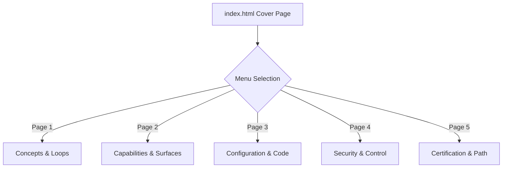

# HTML Presentation Plan: IBM Bob Technical Walkthrough

This document outlines the design and implementation plan to transform the PDF presentation **"IBM Bob — Technical Walkthrough: Software Engineering Practice in the age of AI Coding"** by Carlos Salazar into a lightweight, responsive, and elegant HTML presentation.

## 1. High-Level Requirements

| Requirement | Implementation Strategy |
| :--- | :--- |
| **Cover Page** | Title, author, views disclaimer, and a notice stating information is based on official docs. Includes an interactive SVG Bob head with a floating speech bubble displaying random tips. |
| **Style** | Clean, professional, and lightweight. Palette inspired by the **IBM Carbon Design System** (typography, colors, borders, spacing). No heavy frameworks, pure CSS, vanilla JS, and zero backend code. |
| **Theme Selection** | A toggle situated in the top right that allows users to select between Light and Dark themes, defaulting to Light. |
| **Navigation** | Fixed left-side vertical menu allowing instant switching between structured pages without full page reloads. |
| **Content Clarity** | Content structured into high-readability slides, directly citing and referencing official links from the walkthrough. |
| **Simplicity** | Implemented as a single `index.html` containing HTML, CSS, and JS. Zero build steps, making it immediately deployable to **GitHub Pages**. |

---

## 2. Topic Grouping & Navigation Mapping

The 19 slides from the PDF are structured into **5 logical page categories** (plus the Cover Page) to ensure a high-quality presentation flow:



### Page Breakdown & Sources

1. **Cover Page (`cover`)**
   - *Contents:* Presentation Title, Author (Carlos Salazar), Official Documentation notice, views disclaimer, and the interactive Bob Head tip widget.
   - *Sources:* Slide 1 & Slide 19 (Disclaimer).

2. **Concepts & Loops (`intro`)**
   - *Contents:* What is IBM Bob?, What is an AI Agent?, Agent Harness definition ($Agent = Model + Harness$), and Loop Engineering.
   - *Sources:* Slides 2, 3, 4 & 5.

3. **Capabilities & Surfaces (`capabilities`)**
   - *Contents:* Bob's four primary tools (Read, Write, Terminal, External Services), and product surfaces (Bob IDE vs. Bob Shell).
   - *Sources:* Slides 6 & 7.

4. **Configuration & Code (`config`)**
   - *Contents:* Configuration as a Code Artifact, `.bobignore` data boundaries, `AGENTS.md` standard, `/init` command, Bob Skills format, and Policy Load Order priority.
   - *Sources:* Slides 8, 10, 11, 12, 13 & 14.

5. **Security & Control (`governance`)**
   - *Contents:* Built-in Modes (Agent, Plan, Ask, Custom), task permissions and interactive approvals, Bob Model Router tiers, and extension specs (MCP, Hooks, Plugins, Rollback).
   - *Sources:* Slides 9, 15, 16 & 17.

6. **Certification & Path (`resources`)**
   - *Contents:* Path to IBM Bob Certification (Exam C9010800), Free Trial info (50 Bobcoins), and external developer documentation links.
   - *Sources:* Slides 18 & 19.

---

## 3. Core Component Design

### IBM Carbon Styling Palette

We use CSS variables mapping back to the standard Carbon color palette:

*   **Light Theme (`data-theme="light"`):**
    *   Primary Background: `#f4f4f4` (Gray 10)
    *   Secondary Background/Cards: `#ffffff` (White)
    *   Text: `#161616` (Gray 100)
    *   Primary Accent: `#0f62fe` (Blue 60)
*   **Dark Theme (`data-theme="dark"`):**
    *   Primary Background: `#161616` (Gray 100)
    *   Secondary Background/Cards: `#262626` (Gray 80)
    *   Text: `#f4f4f4` (Gray 10)
    *   Primary Accent: `#78a9ff` (Blue 30)

### Interactive Bob Head & Speech Bubble

*   **Visual Head:** Rendered as an SVG of Bob's high-tech helmet with glowing cyan/purple eyes.
*   **Speech Bubble:** Floats to the right, showing authentic product tips parsed from Bob's official developer documentation.
*   **Dynamic Logic:** Updates with a smooth fade effect every 8 seconds, or instantly on-click via a "Show another tip ↻" control button.

---

## 4. Deployment Instructions

1. Put the entire HTML, CSS, and JS structure into `index.html` at the project root.
2. Push changes to your remote GitHub repository:
   ```bash
   git add index.html PLAN.md
   git commit -m "feat: implement presentation index and documentation plan"
   git push origin main
   ```
3. Enable **GitHub Pages** under repository **Settings** → **Pages**:
   * Build source: *Deploy from a branch*
   * Branch: *main*, Folder: */ (root)*
   * Save.
4. Your presentation will reside live at `https://<username>.github.io/<repository-name>/`.

---

## 5. Repository Status
* **Status**: Initialized & Live 🚀
* **Primary Branch**: Active and successfully pushed to GitHub
